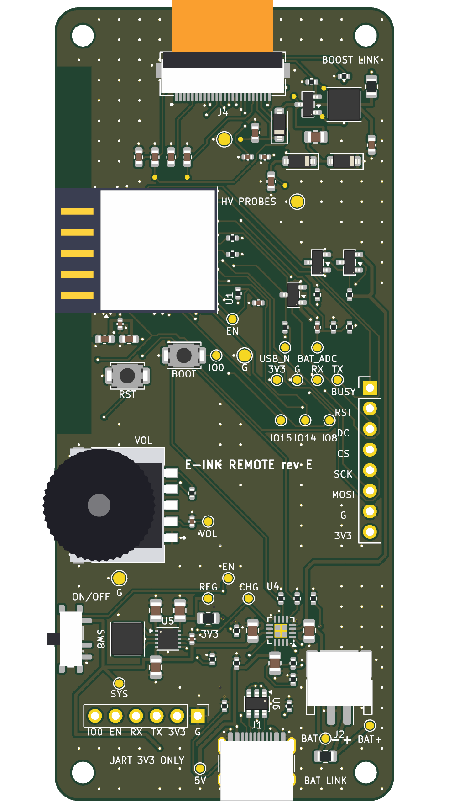

# E-ink Remote

A pocket Spotify remote: ESP32-S3-MINI-1-N8, 2.13-inch portrait e-paper panel, five
buttons, a volume thumbwheel, USB-C and a 1S LiPo, on a 42 × 98 mm four-layer PCB with
four M2.5 mounting holes. Playback happens on another Spotify device; this board has
no audio or microSD hardware.

This is revision E, an unbuilt prototype design. The earlier 1.54-inch, 40 × 78 mm version is tagged `v1-1.54in`
in git. See `DESIGN.md` for the GPIO map, power architecture and revision notes.

Before ordering, run `./check-order.sh`. It checks the existing release and reports
outstanding supplier/physical reviews; it does not regenerate the board.
See `ORDER-READINESS.md` and record evidence in `order-review.json`.

## Repository and branches

The central repository is https://github.com/David-Feldt/ipod-pcb. Use one local
checkout named `ipod-pcb`, with `origin` pointing to that GitHub repository.
The current 2.13-inch design lives on `main`, tracking `origin/main`.
The older 1.54-inch design is preserved at the `v1-1.54in` tag.
The `portrait-2.13` branch is retained as the development history of the
2.13-inch revision. Separate local folders are not needed for each screen size.

For a new checkout:

```sh
git clone --branch main https://github.com/David-Feldt/ipod-pcb.git
cd ipod-pcb
```

Save your work and close the KiCad editors before switching branches. Open
`kicad/eink-pod.kicad_pro` from this checkout after selecting the desired branch.



## Project files

| Path | Contents |
|---|---|
| `kicad/eink-pod.kicad_pro` | KiCad 10 project |
| `kicad/eink-pod.kicad_sch` | Generated schematic |
| `kicad/eink-pod.kicad_pcb` | Generated and routed PCB |
| `kicad/erc.rpt`, `kicad/drc.rpt` | Latest electrical and board checks |
| `kicad/drc-all.rpt` | DRC including silkscreen warnings |
| `kicad/verification.txt` | Circuit/layout regression checks |
| `fab/eink-pod-gerbers.zip` | Gerbers and drill files |
| `fab/eink-pod-bom.csv`, `fab/eink-pod-cpl.csv` | Assembly BOM and placement |
| `fab/eink-pod-schematic.pdf` | Printable schematic |
| `gen/` | Circuit, placement, fixed routing and output generators |
| `firmware/remote/` | ESP-IDF application firmware (see its README) |
| `firmware/bringup/`, `firmware/display_test/` | Arduino bench sketches used for board bring-up |
| `FIRMWARE-NOTES.md` | Firmware requirements agreed during the hardware review |
| `review/` | Hardware review evidence: datasheets, extracts and review pages |

## Rebuilding

Run `./build.sh` with KiCad 10, Python 3, Java and `tools/freerouting.jar` installed.
The script regenerates the schematic and PCB, checks ERC, routes the board,
checks DRC and schematic parity, verifies the critical routes, then refreshes
fabrication files and front/back renders. The final pre-order automated check
compares exact BOM assignments and placements with the PCB and rejects new DRC
findings. It stops if a required check fails; external reviews remain separate.

Edit `gen/build_sch.py` for circuit changes, `gen/build_pcb.py` for placement,
and `gen/critical_routes.py` for USB, decoupling and boost wiring. The router
preserves these explicit routes; `gen/verify_board.py` checks they survived.
Each routing run uses a separate exchange directory to avoid concurrent-build
collisions. Avoid rebuilding while another editor is saving the same board.
Manual edits to generated KiCad files will be overwritten by the next build.

## Layers and fabrication

| Layer | Use |
|---|---|
| F.Cu | Buttons, charge LED, USB pair, other signals and GND pour |
| In1.Cu | GND plane, reference for the long USB pair |
| In2.Cu | 3.3 V plane |
| B.Cu | Main components, signals and GND pour |

Use the JLC04161H-7628 four-layer, nominal 1.6 mm stackup with 1 oz outer and
0.5 oz inner copper. The USB trunk is 0.25 mm wide with 0.15 mm edge spacing;
short connector neckdowns are 0.15 mm wide. Specify a 90-ohm differential target
and confirm it with the fabricator for the actual stackup and copper pours.
DRC does not verify impedance. See `fab/README.md` for ordering notes.

Assembly is on both sides. To use bottom-side assembly only, hand-solder
SW1–SW5, D5, R4 and C40 on the front. Check every assembly rotation, especially the
MOSFETs, USB-C connector, FPC connector and slide switch, in the assembler's
preview. DS1 is a mechanical display model and is excluded from assembly files.
Use `fab/assembly-pin1.csv` and the assembly maps to check pin orientation;
CPL angles use KiCad conventions and still need the JLC order preview check.
**Select epoxy-filled and copper-capped vias:** this design has vias in thermal
pads; ordinary tenting is not an equivalent process.

## Prototype debug access

Revision E adds three removable power links, an unpopulated manual UART header,
an unpopulated DESPI-C02 fallback/bus-probe header, local boost probes, power and
sensing pads, and GPIO8/14/15 access. See `DEBUG.md` and `fab/debug-map.svg`.
J3/J5 are excluded from assembly; R23/R24/R25 are normally fitted. The board
remains 42 × 98 mm.

## Firmware and bring-up

- GPIO2 is now `USB_PRESENT_N`: low means USB is connected. Do not use the old
  active-high `VBUS_DET` logic. Disable internal pulls; R8 is the external pull-up.
- Battery voltage is twice the calibrated GPIO1 ADC voltage. Wait at least
  250 ms after power-on for the switched divider and its 100 nF filter to settle.
- Use GxEPD2's GDEY0213B74 driver (`GxEPD2_213_GDEY0213B74`; confirm the class name
  in the library version you install) and the GPIO map in `DESIGN.md`.
- Charger control: GPIO6/7 drive `CHG_EN1`/`CHG_EN2`. Both are pulled low at
  reset, selecting a **100 mA total USB input limit**. A charged battery supplies
  Wi-Fi peaks. The accepted prototype policy selects USB500 (`EN1=1, EN2=0`)
  early after boot whenever USB is present, assuming a source of at least 500 mA;
  this is not negotiated USB permission (see `FIRMWARE-NOTES.md`). Use
  `EN1=1, EN2=1` on USB suspend. With SW8 OFF the pull-downs keep USB100 charging.
  Charge current is nominally 223 mA when the input budget permits.
- Volume wheel: drive GPIO5 (`VOL_EN`) high, wait ~1 ms, read GPIO4 (`VOL_SENSE`) with
  the ADC, then drive GPIO5 low again. Use the highest ADC attenuation and calibrate the two end positions.
  R19 limits the maximum wiper voltage to about 2.86 V at 3.3 V supply and
  +30% pot tolerance. The pot draws nothing while GPIO5 is low.
  The wheel is absolute (270° travel), so send Spotify a new volume only when the
  wheel moves; a volume change made on the phone will not move the wheel.
- Buttons use internal pull-ups; configure RTC pull-ups and wake behavior for
  deep sleep. BOOT and RESET remain accessible for USB recovery/flashing.
- Use a protected 1S LiPo whose manufacturer allows at least 250 mA charging. Verify the
  JST lead polarity; battery connectors are not universally wired the same way.
- Test USB in both orientations, Wi-Fi during low battery and screen refresh,
  off/sleep current, and charging temperature before relying on runtime estimates.
- Fit the actual display flex, battery and enclosure before ordering a batch.
  Four 2.7 mm unplated M2.5 holes sit 3.5 mm in from each corner. Screw heads or
  bosses on the front must stay within 4.5 mm diameter at the top two holes to clear
  the display glass. Use a nylon screw in the top-right hole, which is closest to the
  antenna. Keep the battery and conductive enclosure/display features away from
  the antenna region, then test radio performance in the assembled device.

Application firmware is in progress in `firmware/remote/`. Board 1 bring-up results are
recorded in the `BRINGUP.md` bench log; batch acceptance measurements remain open.
See `BRINGUP.md` for acceptance measurements and `MECHANICAL.md` for the verified
drawing dimensions and the remaining physical fit check.
