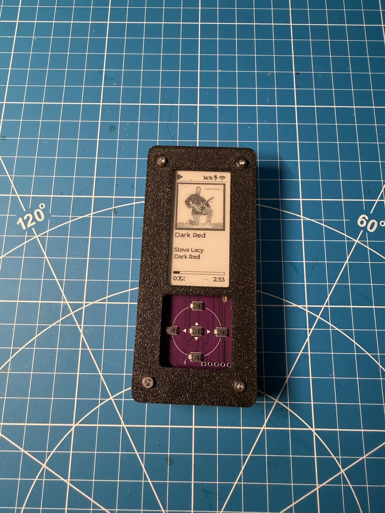
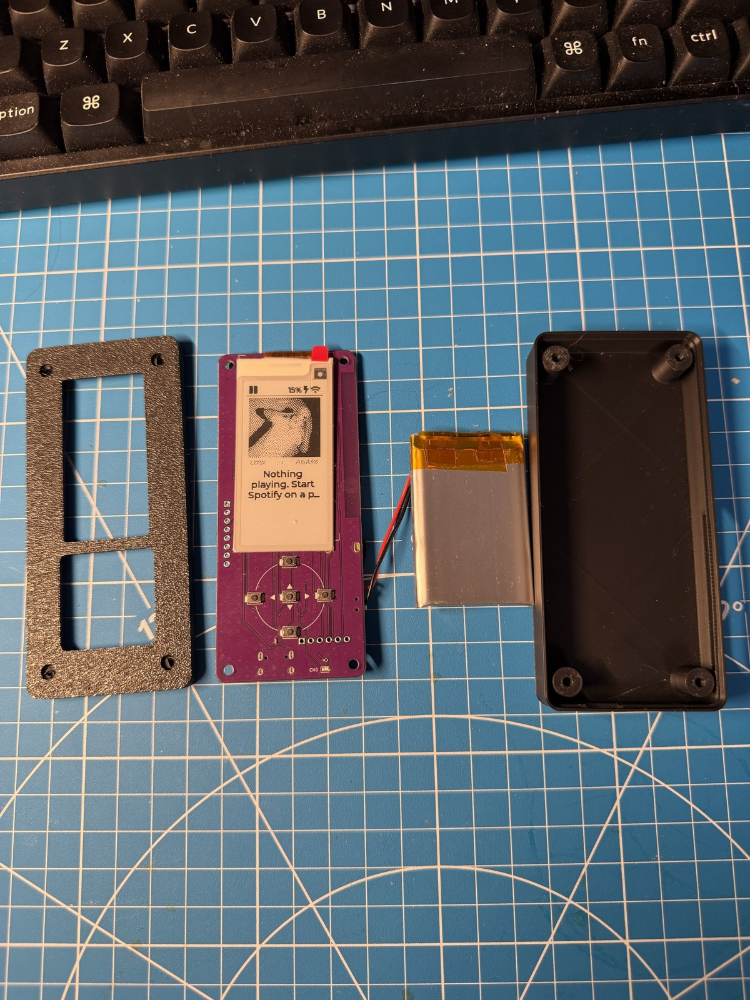

# E-ink Spotify iPod

A pocket Spotify remote with an e-paper screen. It shows what's playing (with
dithered album art), and its buttons and thumbwheel control playback and volume
on whichever device Spotify is playing on. It has no speaker or headphone jack.

<p>
  
  
</p>

## At a glance

| | |
|---|---|
| Chip | ESP32-S3-MINI-1-N8 (Wi-Fi + Bluetooth LE, 8 MB flash) |
| Screen | 2.13-inch GDEY0213B74 e-paper, 122 × 250, portrait |
| Controls | Five buttons and an absolute volume thumbwheel |
| Power | USB-C charging, 1S LiPo |
| Board | Revision E, 42 × 98 mm, four layers, four M2.5 mounting holes |
| Status | Board 1 is built and running the firmware |

## What it does

- **Now playing:** title, artist, progress and album art, from the Spotify Web API
  over Wi-Fi.
- **Controls:** play/pause, previous/next track, and wheel volume.
- **Easy setup:** a Wi-Fi setup hotspot, then Spotify sign-in from your phone.
- **Bluetooth fallback:** when Wi-Fi is out of range, it works as a Bluetooth
  media remote for your phone.
- **Battery care:** shows a "Battery low" screen and sleeps when the battery runs
  down.

## Repository guide

| Path | What's there |
|---|---|
| `firmware/remote/` | ESP-IDF application firmware: build and usage in its README |
| `kicad/` | KiCad 10 project, generated schematic and PCB, check reports |
| `gen/` | Python generators for the schematic, placement, routing and outputs |
| `fab/` | Gerbers, BOM, placement file, printable schematic, ordering notes |
| `pairing/` | Static sign-in bounce page used during Spotify pairing |
| `renders/`, `photos/` | Board renders and photos of the built device |
| `review/` | Hardware review evidence and datasheets |

| Document | Read it for |
|---|---|
| `DESIGN.md` | GPIO map, power architecture, revision notes |
| `FIRMWARE-NOTES.md` | Hardware rules the firmware must follow (charger, battery, wheel, display) |
| `BRINGUP.md` | Bring-up procedure and bench log |
| `DEBUG.md` | Debug links, pads and headers |
| `MECHANICAL.md` | Verified dimensions and enclosure fit |
| `ORDER-READINESS.md` | What must be checked before ordering boards |

## Getting started

```sh
git clone https://github.com/David-Feldt/ipod-pcb.git
cd ipod-pcb
```

Everything current is on `main`. The older 1.54-inch, 40 × 78 mm design is
tagged `v1-1.54in`. The `portrait-2.13` branch keeps the development history of
the 2.13-inch revision.

To open the board, close any running KiCad editors and open
`kicad/eink-pod.kicad_pro`.

## Rebuilding the board

Requires KiCad 10, Python 3, Java and `tools/freerouting.jar`.

```sh
./build.sh        # regenerate schematic, PCB, routing, fab files and renders
./check-order.sh  # pre-order gate: automated checks plus pending reviews
```

`build.sh` runs ERC, routing, DRC, schematic parity and critical-route checks,
and stops if any of them fails. Don't edit the generated KiCad files by hand:
the next build overwrites them. Edit the generators instead:

| Change | Edit |
|---|---|
| Circuit | `gen/build_sch.py` |
| Placement | `gen/build_pcb.py` |
| USB, decoupling and boost wiring | `gen/critical_routes.py` (checked by `gen/verify_board.py`) |

Don't run two builds at once or rebuild while an editor is saving the board.

## Ordering

Run `./check-order.sh` first and record external evidence in
`order-review.json`. Things to choose at the fab (details in `fab/README.md`):

- **Stackup:** JLC04161H-7628, four layers, 1.6 mm, with a 90-ohm differential
  target for USB.
- **Vias:** epoxy-filled and copper-capped. This design has vias in thermal pads,
  so ordinary tenting won't do.
- **Assembly:** both sides. Check every rotation in the assembler's preview
  against `fab/assembly-pin1.csv`. Take extra care with the MOSFETs, USB-C, FPC
  connector and slide switch.

| Layer | Use |
|---|---|
| F.Cu | Buttons, charge LED, USB pair, signals, GND pour |
| In1.Cu | GND plane, reference for the USB pair |
| In2.Cu | 3.3 V plane |
| B.Cu | Main components, signals, GND pour |

## Building and testing a board

- **Battery:** use a protected 1S LiPo rated for at least 250 mA charging, and
  check the JST lead polarity before plugging it in.
- **Mounting:** front screw heads or bosses at the top two holes must stay within
  4.5 mm diameter to clear the display glass. Use a nylon screw in the top-right
  hole, next to the antenna.
- **Test:** USB in both orientations, Wi-Fi during low battery and screen
  refresh, sleep current, charging temperature, and radio range in the assembled
  case.

See `BRINGUP.md` for the full procedure and `DEBUG.md` for the debug links and
headers.
